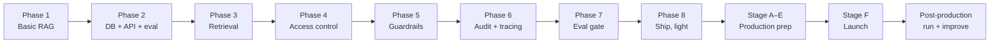
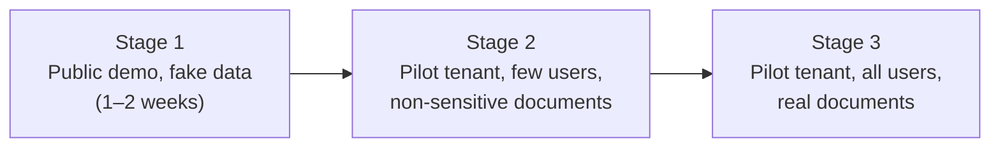

# Production Plan — From Learning Project to a Running Service

What it takes to run the Secure RAG Assistant in production: every step before launch, the launch
itself, what we must **not** do, the backup and disaster-recovery plan, and everything after launch.

**Status (2026-10-13):** Phase 1 built; production is the stage *after* Phase 8 (see §2). Nothing in
this document is built yet. Items marked **[decide]** need an owner decision first (§3).

**How to use this file:** work top to bottom. Each step has a checkbox, who does it, and how you know
it's done. Because this is a learning-by-doing project, each stage also says what you learn.
Record progress in `context/progress-tracker.md` and the daily entry in `lessons/learning-log.md`.

---

## Contents

1. [What "production" means here](#1-what-production-means-here)
2. [Where production fits in the plan](#2-where-production-fits-in-the-plan)
3. [Decisions before production](#3-decisions-before-production)
4. [Production readiness gates](#4-production-readiness-gates)
5. [Stage A — Prepare the infrastructure](#5-stage-a--prepare-the-infrastructure)
6. [Stage B — Secure everything](#6-stage-b--secure-everything)
7. [Stage C — Observability and alerts](#7-stage-c--observability-and-alerts)
8. [Stage D — CI/CD and release process](#8-stage-d--cicd-and-release-process)
9. [Stage E — Pre-launch testing](#9-stage-e--pre-launch-testing)
10. [Stage F — Launch](#10-stage-f--launch)
11. [What we must NOT do](#11-what-we-must-not-do)
12. [Backup and disaster recovery](#12-backup-and-disaster-recovery)
13. [Fallback plans (Plan B for every failure)](#13-fallback-plans-plan-b-for-every-failure)
14. [Post-production: running the service](#14-post-production-running-the-service)
15. [Post-production: improving the service](#15-post-production-improving-the-service)
16. [Costs](#16-costs)
17. [Master checklist](#17-master-checklist)

---

## 1. What "production" means here

**Production** = the system runs on a server you don't sit at, real people use it, and it keeps
working (or fails safely) when you're not watching.

| | Development (today) | Production |
|---|---|---|
| Where it runs | Your Mac | A server on the internet, behind HTTPS |
| Who uses it | You | Real users of at least one tenant |
| Data | Fake Aldermoor documents | Real (or realistic) documents, possibly with real personal data |
| When it breaks | You notice and restart it | An alert fires; it fails **closed**; a runbook says what to do |
| Changes | Edit and run | Tested, evaluated, reviewed, deployed by CI, reversible |
| Data loss | Annoying | Unacceptable — backups are tested |

**Scope of "production" for this project.** The architecture (`docs/architecture.md` §10) targets
**Docker Compose on one server**: suitable for a pilot with a small company or a public demo. It is
honest about limits (§14 of the architecture): no SSO, no WORM audit storage, no Kubernetes,
single region. Moving beyond that is in §15.

---

## 2. Where production fits in the plan

**Rule:** do not start production stages until Phases 1–7 are done. Production without access control
(Phase 4), guards (Phase 5), audit (Phase 6), and the eval gate (Phase 7) would expose real data
to exactly the risks this project exists to prevent.

Some production work starts early because it's cheap then and painful later:

| Production concern | Starts in |
|---|---|
| Secrets out of git, `.env.example` | Phase 0 ✅ |
| Non-superuser DB role (RLS works only for non-superusers) | Phase 2 |
| Migrations append-only, versioned | Phase 2 |
| Redacted logging, no raw PII anywhere | Phase 2, enforced in Phase 5 |
| Fail-closed guards | Phase 5 |
| Audit trail + `/verify` | Phase 6 |
| Eval gate in CI | Phase 7 |
| Docker images, one-command start | Phase 8 |

**Estimated timeline:** production prep (Stages A–E) ≈ 3–4 weeks at 10–12 h/week; launch ≈ 1 week
including a pilot; post-production is ongoing.

---

## 3. Decisions before production

Each needs an answer before Stage A. Recommendations are given; the owner decides.

| # | Decision | Options | Recommendation |
|---|----------|---------|----------------|
| D-P1 | **Who are the users?** | (a) public demo with fake data; (b) pilot with a real small company; (c) internal team use | **(a) first**, then (b) only after a successful (a) |
| D-P2 | **Hosting** | Single VM (Hetzner, DigitalOcean, AWS Lightsail) with Docker Compose; or managed services (managed Postgres + container platform) | **One VM + Docker Compose** for (a); add managed Postgres for (b) |
| D-P3 | **Hosting budget** | The agreed < $20 covers *AI services only*; a server costs ~$6–25/month | **[decide]** — needed before Stage A |
| D-P4 | **Domain + HTTPS** | Own domain (~$10/year) or a free subdomain | Own domain; HTTPS via Caddy (automatic certificates) |
| D-P5 | **Data region** | Where servers and backups live (matters for UK/EU personal data) | Same region as the users (e.g. EU/UK) |
| D-P6 | **LLM provider data policy** | Providers may retain prompts; real personal data needs a zero-retention / no-training agreement | For (b): use only providers and settings with **no training on your data**; document it |
| D-P7 | **Who is on call?** | For a learning project: the owner, best effort | Owner; alerts to email + phone; documented hours |
| D-P8 | **Embedding-outage behaviour** | Fail closed (refuse) or degrade to keyword-only search | **Fail closed** at first; degraded mode needs an ADR (§13.3) |

---

## 4. Production readiness gates

All must be ✅ before launch (Stage F). Each gate is objective — a number or a passing check.

| Gate | Requirement | Measured by |
|------|-------------|-------------|
| G1 Quality | Recall@5 ≥ 0.85; answer correctness ≥ 0.75; faithfulness ≥ 0.85 | Eval suite (Phase 7) |
| G2 Security | Injection block rate ≥ 95 % (95 % CI reported); false refusals ≤ 5 % | Adversarial + benign sets |
| G3 Isolation | **0** cross-tenant leaks; ACL-change test passes; RLS test with a removed `WHERE` passes | Canary + leakage tests |
| G4 Latency | p95 ≤ 8 s under expected load | Load test (§9.3) |
| G5 Audit | `/v1/audit/verify` passes; tampering a row is detected | Audit tests |
| G6 Backups | A full restore to a fresh server succeeded in the last 30 days | Restore drill (§12.6) |
| G7 Fail-closed | Every guard and provider outage results in a refusal, never a pass-through | Chaos tests (§9.4) |
| G8 Secrets | No secret in git history, images, or logs | Secret scan (§6.4) |
| G9 Runbooks | Restore, rollback, key rotation, incident response written and rehearsed once | `docs/runbooks/` |
| G10 Cost | Per-tenant token budget enforced; provider spend caps set | Config + test |

---

## 5. Stage A — Prepare the infrastructure

**You learn:** servers, networking basics, Docker Compose in practice, reverse proxies, DNS, HTTPS.

### A1. Environments
- [ ] **A1.1** Define three environments: `dev` (your Mac), `staging` (a copy of production with fake data), `production`. *(you)*
- [ ] **A1.2** One config file per environment (`.env.dev`, `.env.staging`, `.env.prod` — never committed); only `.env.example` in git. *(you)*
- [ ] **A1.3** Staging uses the **same images and compose file** as production — only config differs. *Done when:* a deploy to staging and production uses one command with an environment name.

### A2. Server
- [ ] **A2.1** Create the VM (D-P2): 4 vCPU / 8 GB RAM is enough (reranker + injection classifier on CPU). *(you)*
- [ ] **A2.2** OS updates on; automatic security updates enabled.
- [ ] **A2.3** Create a non-root deploy user; disable root SSH login and password login; SSH keys only.
- [ ] **A2.4** Firewall: allow only 22 (SSH, your IP if possible), 80, 443. **Postgres, Redis, MinIO, Langfuse never exposed to the internet.**
- [ ] **A2.5** Install Docker and the Compose plugin; enable restart on boot.
- *Done when:* `nmap` from outside shows only 22/80/443 open.

### A3. Domain and HTTPS
- [ ] **A3.1** Buy/assign the domain (D-P4); DNS `A` record → server IP.
- [ ] **A3.2** Caddy as reverse proxy in the compose file: automatic HTTPS certificates, HTTP → HTTPS redirect, security headers (HSTS, no-sniff, frame-deny).
- [ ] **A3.3** Request size limit (uploads ≤ e.g. 20 MB) and timeouts at the proxy.
- *Done when:* `https://<domain>/healthz` returns OK with a valid certificate; `http://` redirects.

### A4. Services (Docker Compose)
- [ ] **A4.1** Services: `caddy`, `api` (FastAPI, N replicas), `worker` (ingestion), `postgres` (16 + pgvector), `redis`, `minio` (or a local volume), `langfuse`.
- [ ] **A4.2** Every image pinned to an exact version/digest — never `latest`.
- [ ] **A4.3** Health checks on every service; `restart: unless-stopped`.
- [ ] **A4.4** Resource limits (memory/CPU) so one service can't starve the others.
- [ ] **A4.5** Named volumes for Postgres, MinIO, Langfuse data; documented paths.
- *Done when:* `docker compose up -d` brings everything up healthy from zero on a fresh server, with seeded demo data.

### A5. Database
- [ ] **A5.1** Postgres tuned for the server size (shared_buffers, work_mem); pgvector ≥ 0.8 (iterative scan for filtered HNSW).
- [ ] **A5.2** Roles: `migrator` (owns schema, runs migrations), `rag_app` (non-superuser, RLS applies), `readonly_support` (optional). App **never** connects as superuser.
- [ ] **A5.3** RLS enabled and **forced** on tenant tables; tested in staging.
- [ ] **A5.4** Encryption at rest: encrypted disk/volume (the DB holds raw PII by design — ADR-0004).
- [ ] **A5.5** Connection limits and a pool in the API.
- *Done when:* the RLS leakage test passes against staging, connected as `rag_app`.

---

## 6. Stage B — Secure everything

**You learn:** threat modelling in practice, secret management, supply-chain security, auth hardening.

### B1. Identity and access
- [ ] **B1.1** JWT signing keys (RS256) generated for production only; private key never leaves the server/secret store; 15-minute token expiry.
- [ ] **B1.2** Roles and permissions loaded from the DB on every request (revocation is immediate).
- [ ] **B1.3** First tenant admin created by a one-off script, not by an open signup endpoint.
- [ ] **B1.4** Admin/auditor endpoints require their role **and** tenant match — tested.

### B2. Data protection
- [ ] **B2.1** Presidio PII masking active for users without `pii:read`; verified on real-looking data.
- [ ] **B2.2** Logs, traces, audit tables contain **only redacted text** (Invariant 5) — verified by grepping staging logs for planted fake PII.
- [ ] **B2.3** Uploads: file type and size checked; files stored privately (MinIO bucket not public).
- [ ] **B2.4** Data retention defined: how long documents, requests, audit events, traces, and backups are kept (§14.7).

### B3. Abuse and cost protection
- [ ] **B3.1** Redis rate limits per user and per tenant.
- [ ] **B3.2** Daily token budget per tenant; requests beyond it get a clear 429.
- [ ] **B3.3** Hard spend caps / alerts set in each provider's billing console (OpenAI, Groq, others).

### B4. Secrets and supply chain
- [ ] **B4.1** Production secrets only in the server's environment / secret store; **rotation procedure** written (§14.5).
- [ ] **B4.2** Secret scanning on every push (e.g. gitleaks in CI); scan the full git history once.
- [ ] **B4.3** Dependency scanning (e.g. `pip-audit`) and image scanning (e.g. Trivy) in CI; block on critical vulnerabilities.
- [ ] **B4.4** Docker images built in CI from `uv.lock` (reproducible), run as a non-root user, minimal base image.
- [ ] **B4.5** Pin model versions explicitly in config (no floating aliases); record them on each request.

### B5. LLM-specific security
- [ ] **B5.1** The LLM has **no tools** (Invariant 3) — reviewed.
- [ ] **B5.2** Output checks strip URLs, images, HTML (Invariant 3).
- [ ] **B5.3** Guards fail closed on timeout/outage (Invariant 4) — tested in §9.4.
- [ ] **B5.4** Ingest-time injection scan quarantines poisoned documents; quarantine review procedure written.
- [ ] **B5.5** A short **security self-review** against `docs/architecture.md` §6 and §11, documented.

---

## 7. Stage C — Observability and alerts

**You learn:** logs vs metrics vs traces, SLOs, alerting that doesn't cry wolf.

### C1. Logs
- [ ] **C1.1** Structured JSON logs with `request_id`, tenant id, status, latency — **no raw text**.
- [ ] **C1.2** Log rotation and retention (e.g. 30 days) so the disk never fills.

### C2. Metrics
- [ ] **C2.1** Track per minute: requests, status mix (answered / no_answer / refused / error), p50/p95 latency, tokens and cost per tenant, guard verdict counts, ingestion queue length, DB connections, disk usage.
- [ ] **C2.2** A simple dashboard (Langfuse for LLM traces + a basic metrics view, e.g. Grafana or a Postgres-backed page).

### C3. Traces
- [ ] **C3.1** Langfuse traces per request (redacted), showing time per step: guard, retrieve, rerank, generate, judge.

### C4. Alerts (to email + phone)

| Alert | Condition | Severity |
|-------|-----------|----------|
| Service down | `/healthz` fails 3× in a row from an external uptime checker | Critical |
| Error rate | > 5 % `error` status over 10 min | Critical |
| Audit chain broken | Daily `/v1/audit/verify` fails | Critical |
| Canary leak | Any canary string detected in an answer | Critical |
| Backup failed / missing | No successful backup in 26 h | High |
| Latency | p95 > 8 s over 15 min | High |
| Refusal spike | Refusal rate 3× its 7-day average | Medium (possible attack or broken guard) |
| No-Answer spike | No-Answer rate 2× its 7-day average | Medium (possible retrieval regression) |
| Spend | Daily cost > budget threshold | High |
| Disk | > 80 % full | High |

- [ ] **C4.1** External uptime checker configured.
- [ ] **C4.2** Each alert above configured and **test-fired once**.
- [ ] **C4.3** Each alert links to its runbook section.

---

## 8. Stage D — CI/CD and release process

**You learn:** pipelines, safe deploys, rollbacks, migrations without downtime.

### D1. Continuous integration (every push / PR)
- [ ] **D1.1** `uv sync` → `ruff check` → `pytest` (offline + `db` tests with a throwaway Postgres).
- [ ] **D1.2** Secret scan, dependency scan, image build + scan.
- [ ] **D1.3** **Eval gate** (Phase 7) on PRs touching retrieval, guards, prompts, or models: fail if any threshold in `eval/thresholds.yaml` is missed.

### D2. Release
- [ ] **D2.1** Every merge to `main` builds images tagged with the git commit; releases tagged `vX.Y.Z` with a CHANGELOG entry.
- [ ] **D2.2** Deploy order: **staging first**, automatic smoke tests, then a manual "promote to production".
- [ ] **D2.3** Production deploy = pull new images → run migrations → rolling restart of `api` → smoke test → done. Keep the previous image tags.

### D3. Database migrations in production
- [ ] **D3.1** Migrations are **append-only** and backward compatible ("expand → migrate → contract"): add new columns/tables first, deploy code that uses both, remove old ones in a later release.
- [ ] **D3.2** Take a backup immediately before every migration.
- [ ] **D3.3** Never a migration that rewrites `audit_events` rows (append-only by trigger).

### D4. Rollback
- [ ] **D4.1** Rollback = redeploy the previous image tag (one command). Because migrations are backward compatible, the old code still works with the new schema.
- [ ] **D4.2** Rollback rehearsed once in staging. *Done when:* rollback takes < 10 minutes end to end.

---

## 9. Stage E — Pre-launch testing

**You learn:** testing a whole system, not just functions — load, failure, and attack.

### E1. Functional
- [ ] **E1.1** Full eval suite on staging with production configuration; all gates G1–G3 pass.
- [ ] **E1.2** End-to-end user flows: upload → ingest → ask → audit lookup → verify, per role (reader, uploader, auditor).

### E2. Security
- [ ] **E2.1** Adversarial set (≥ 300) on staging; block rate and false refusals recorded with 95 % CI.
- [ ] **E2.2** Manual red-team session (2 hours): try to leak tenant B, extract PII, inject via uploaded documents, exfiltrate via links.
- [ ] **E2.3** Auth tests: expired token, wrong tenant, removed role, tampered JWT → all rejected.

### E3. Load
- [ ] **E3.1** Load test with realistic traffic (e.g. 5 concurrent users, 30 minutes) using a load tool (k6 or Locust).
- [ ] **E3.2** Record p50/p95 latency, error rate, cost per query; G4 must pass.
- [ ] **E3.3** Find the breaking point (increase until errors) and write it down as current capacity.

### E4. Failure ("chaos") tests — the system must fail **closed**
- [ ] **E4.1** Stop the LLM provider (wrong key) → requests refused with `status=error`, audited.
- [ ] **E4.2** Stop the embedding provider → refused (or degraded mode, if D-P8 chose it).
- [ ] **E4.3** Stop the injection classifier → refused, never skipped.
- [ ] **E4.4** Stop Redis → defined behaviour (fail closed on rate limits) documented.
- [ ] **E4.5** Restart Postgres mid-traffic → requests error cleanly and recover.
- [ ] **E4.6** Fill the disk on staging → alerts fire before failure.

### E5. Recovery
- [ ] **E5.1** Full restore drill (§12.6) on a fresh server. G6 passes.
- [ ] **E5.2** Rollback drill (§8, D4.2).

---

## 10. Stage F — Launch

**You learn:** release management, staged rollouts, communicating with users.

### F1. Go / no-go meeting (with yourself, written down)
- [ ] **F1.1** All gates G1–G10 ✅, with evidence links.
- [ ] **F1.2** All Critical/High alerts tested.
- [ ] **F1.3** Runbooks exist: restore, rollback, key rotation, incident response, quarantine review.
- [ ] **F1.4** A launch window chosen: a weekday morning when you're available for 4+ hours. **Never** Friday evening.

### F2. Launch day runbook
1. [ ] Announce a maintenance window (if users exist).
2. [ ] Take and verify a fresh backup.
3. [ ] Deploy the release tag to production (D2.3).
4. [ ] Run smoke tests: `/healthz`, one answerable question, one unanswerable question, one injection attempt (must refuse), one audit lookup, `/v1/audit/verify`.
5. [ ] Watch dashboards for 60 minutes: error rate, latency, refusals, cost.
6. [ ] Record the launch in `CHANGELOG.md`, `context/progress-tracker.md`, `lessons/learning-log.md`.

### F3. Staged rollout

- [ ] **F3.1** Advance a stage only if, for its whole duration: 0 leaks, error rate < 1 %, p95 ≤ 8 s, no Critical alert unexplained.
- [ ] **F3.2** Before Stage 2: written agreement with the pilot company on data use, retention, and the LLM provider policy (D-P6).
- [ ] **F3.3** Rollback criterion written in advance: what result makes you roll back without debate (e.g. any canary leak, any confirmed cross-tenant access).

---

## 11. What we must NOT do

Each rule exists for a reason; breaking one needs an ADR first.

### Security and data
| ❌ Don't | Why |
|---|---|
| Expose Postgres, Redis, MinIO, or Langfuse to the internet | One misconfiguration = full data breach |
| Connect the app to Postgres as a superuser | Superusers **bypass RLS** — tenant isolation silently disappears |
| Filter tenants only in Python | A missing `WHERE` leaks data; RLS is the backstop (ADR-0002) |
| Log, trace, or store raw questions, answers, or PII | Logs are copied widely and rarely protected (Invariant 5) |
| Commit secrets, or bake them into Docker images | Images and git history are copied everywhere |
| Give the LLM tools (web, email, code execution) | A successful injection could then *act*, not just talk (Invariant 3) |
| Let answers contain links, images, or HTML | Classic data-exfiltration channel (Invariant 3) |
| Skip a guard when it's down ("fail open") | Attackers trigger outages on purpose (Invariant 4) |
| Use real customer data in dev or staging | Dev machines and staging are less protected |
| Send real personal data to a provider that trains on inputs | Data leaves your control permanently (D-P6) |

### Reliability and process
| ❌ Don't | Why |
|---|---|
| Deploy without the eval gate passing | Quality and security regressions ship silently |
| Use `latest` tags or floating model aliases | Something changes under you with no record of what |
| Edit an applied migration, or update/delete audit rows | Breaks reproducibility and the hash chain (Invariant 6) |
| Deploy on Friday evening or before being away | Nobody to respond if it breaks |
| Change a model, prompt, and retrieval setting in one release | You can't tell which change moved the numbers |
| Stream tokens to users | The output guard must see the full answer first (ADR-0003) |
| Cache answers or retrieval results | Stale answers after an ACL change = leakage |
| Trust a backup that was never restored | Untested backups often don't work |
| Ignore a Medium alert repeatedly | Alert fatigue → the Critical one gets ignored too |

### Scope (not now)
| ❌ Not now | Revisit when |
|---|---|
| Kubernetes | More than one server is genuinely needed |
| Multi-turn chat | Single-turn is stable and evaluated; needs new injection analysis |
| Fine-tuning | A clear skill gap that prompting and RAG can't fix |
| SSO/SAML, WORM audit storage | A real company requires them |

---

## 12. Backup and disaster recovery

**You learn:** RPO/RTO, the 3-2-1 rule, point-in-time recovery, restore drills.

### 12.1 Targets
| Term | Meaning | Target (Stage 1–2) | Target (Stage 3) |
|------|---------|--------------------|------------------|
| **RPO** — recovery point objective | Max data you can afford to lose | 24 hours | 15 minutes |
| **RTO** — recovery time objective | Max time to be back up | 8 hours | 4 hours |

### 12.2 What to back up
| Data | Where | How | Frequency | Keep |
|------|-------|-----|-----------|------|
| Postgres (documents, chunks, users, requests, **audit_events**) | `postgres` volume | `pg_dump` (Stage 1–2); WAL archiving / point-in-time recovery with pgBackRest or a managed DB (Stage 3) | Nightly dump; continuous WAL (Stage 3) | 7 daily, 4 weekly, 3 monthly |
| Original uploaded files | MinIO / volume | Object sync to off-site storage | Nightly | Same as documents' retention |
| Configuration (compose file, Caddy config) | git | Already in the repo | Every change | Forever |
| Secrets (keys, JWT signing key) | Secret store | Encrypted export to a password manager / offline | On change | Current + previous |
| Langfuse data | its volume | Optional (traces are redacted, rebuildable) | Weekly | 4 weeks |

### 12.3 The 3-2-1 rule
- [ ] **3** copies of the data (production + 2 backups)
- [ ] **2** different storage types (server disk + object storage)
- [ ] **1** copy **off-site** (different provider or region)
- [ ] Backups **encrypted** before they leave the server (they contain raw PII by design)
- [ ] Backup storage is **write-once or versioned**, so a compromised server can't delete its own backups

### 12.4 Backup jobs
- [ ] **12.4.1** Nightly backup script (cron or a compose service), logs success/failure.
- [ ] **12.4.2** Backup success writes a heartbeat; the "backup missing" alert (§7) watches it.
- [ ] **12.4.3** Each backup file includes a checksum; verify it after upload.

### 12.5 Restore runbook (write in `docs/runbooks/restore.md`)
1. [ ] Declare an incident (§14.4); stop writes (put the API in maintenance mode).
2. [ ] Provision a clean server (Stage A steps, or a prepared image).
3. [ ] Restore secrets from the secret backup.
4. [ ] Restore Postgres from the latest good backup (or to a point in time with WAL).
5. [ ] Restore original files from object storage.
6. [ ] Run migrations to the deployed version (should be a no-op).
7. [ ] Run `GET /v1/audit/verify` for every tenant — **the hash chain must be intact**.
8. [ ] Run smoke tests (F2 step 4) and a short eval on staging-like data.
9. [ ] Switch DNS / proxy to the restored server; end maintenance mode.
10. [ ] Record the incident and actual RPO/RTO; postmortem within 48 h.

### 12.6 Restore drills
- [ ] **Monthly**: restore last night's backup to a scratch server; run steps 4–8; record time taken.
- [ ] **Quarterly**: full drill from step 1, timed against RTO.
- A drill that fails is a **Critical** finding — fix before anything else.

---

## 13. Fallback plans (Plan B for every failure)

| # | Failure | Plan A (prevent) | Plan B (respond) | Plan C (last resort) |
|---|---------|------------------|------------------|----------------------|
| 13.1 | **LLM provider down / rate-limited** | Retries with backoff; provider status alerts | Switch `CHAT_MODEL` to the pre-tested fallback provider (config only — Phase 1 proved swapping works). Fallback must be re-evaluated before use | Fail closed: "The assistant is temporarily unavailable" |
| 13.2 | **Grounding-judge model down** | Same as 13.1 | Fallback judge from another family | Fail closed (never answer unjudged) |
| 13.3 | **Embedding provider down** | Embedding cache for repeated queries | **[decide D-P8]** Degraded keyword-only search (still RLS-filtered) — needs an ADR | Fail closed |
| 13.4 | **Embedding model retired** by provider | Pin versions; watch deprecation notices | Re-embed all chunks with the new model into a new column, switch atomically, re-run eval | Fall back to local `bge-small` (re-embed, re-baseline) |
| 13.5 | **Bad deploy** (errors, quality drop) | Eval gate + staging + smoke tests | Roll back to previous image tag (< 10 min) | Restore DB to pre-migration backup |
| 13.6 | **Database corruption / server lost** | Backups, monitoring, encrypted volumes | Restore runbook §12.5 | Rebuild from off-site backup on another provider |
| 13.7 | **Cost blow-up** (abuse, loop, bug) | Rate limits, tenant token budgets, provider caps | Kill switch: per-tenant disable flag; lower budgets | Rotate API keys; disable the service |
| 13.8 | **Cross-tenant leak or canary detected** | RLS + role filter + canary tests | **Immediately disable answering** (maintenance mode); preserve evidence; investigate via audit trail | Notify affected tenant; follow incident process; postmortem; no restart until root cause fixed and tested |
| 13.9 | **Successful prompt injection found** | Layered guards | Add the case to the adversarial set; quarantine the document; patch guard; re-run eval | Disable uploads until fixed |
| 13.10 | **Secret leaked** (key in a log, repo, screenshot) | Secret scanning | Rotate the key immediately (§14.5); check provider usage for abuse | Revoke all tokens; force re-login |
| 13.11 | **You (the operator) unavailable** | Alerts, runbooks | A documented "safe off" procedure anyone can follow | Service stays failed-closed until you return |

---

## 14. Post-production: running the service

**You learn:** operations — the part most portfolios never show.

### 14.1 Service level objectives (SLOs)
| SLO | Target |
|-----|--------|
| Availability (healthz from outside) | ≥ 99.5 % per month |
| p95 latency (answered) | ≤ 8 s |
| Error rate | < 1 % |
| Cross-tenant leaks | 0 — always |
| Audit chain integrity | 100 % of daily verifications pass |

### 14.2 Routine schedule
| When | Task |
|------|------|
| **Daily (automatic)** | Backups; `/v1/audit/verify` per tenant; canary scan; cost report |
| **Daily (you, 5 min)** | Glance at dashboard and alerts; update the learning log |
| **Weekly** | Run the eval suite against production config; review refusals and No-Answers for patterns; review the feedback queue |
| **Monthly** | Restore drill; dependency and image updates (via CI); cost review; review access (who has which role) |
| **Quarterly** | Full DR drill; red-team session; rotate secrets; review retention and delete expired data; review this plan |

### 14.3 Feedback loop
1. Users rate answers (`POST /v1/feedback`).
2. Ratings go to a **review queue** — never straight into the eval set.
3. You review: real problem? → add a case to the golden or adversarial set (human-approved only).
4. Fix → eval gate proves the fix → release.

### 14.4 Incident response
1. **Detect** (alert or report) → 2. **Declare** (write the time and severity) → 3. **Contain** (maintenance mode, disable a tenant, rotate a key) → 4. **Investigate** (audit trail, traces, logs) → 5. **Recover** (rollback/restore/fix) → 6. **Communicate** (affected users/tenants) → 7. **Postmortem** within 48 h: what happened, why, what changes so it can't recur — blameless, written in `docs/incidents/`.

### 14.5 Key and secret rotation
- [ ] Every 90 days and immediately after any suspected leak: LLM/embedding API keys, JWT signing key (publish new key, accept both briefly, retire old), database passwords, backup encryption key (keep old one to read old backups).

### 14.6 Model and prompt changes
- [ ] Any change to a model, prompt, chunk size, or retrieval setting = a normal release through the eval gate.
- [ ] Provider model updates (even "same name") → re-run the eval and compare with the baseline before accepting.
- [ ] Record `prompt_version`, model ids, and corpus version on every request (already designed).

### 14.7 Data lifecycle
- [ ] Retention per data type (documents, requests, traces, backups) written and enforced by a scheduled job.
- [ ] **Deletion requests** (e.g. a user leaves, a tenant ends): delete documents, chunks, originals, and requests; audit rows keep only redacted text and ids. Because the audit trail is append-only, the deletion is itself recorded as an audit event. Design decision needed for full erasure inside backups (e.g. backups age out within the retention window) — **[decide]**, write an ADR.
- [ ] Tenant offboarding runbook: export (if agreed) → delete → verify → record.

---

## 15. Post-production: improving the service

Each item is a future phase with its own grilling, spec, ADR where needed, and eval evidence.

| Improvement | Why | Prerequisite |
|-------------|-----|--------------|
| Multi-turn conversations | Users expect follow-ups | Query rewriting + new injection analysis; eval for conversations |
| SSO (OIDC/SAML) | Companies won't manage separate passwords | A real tenant asking for it |
| WORM audit storage | Stronger tamper-evidence for regulated customers | Object lock storage; ADR |
| Answer caching | Lower cost/latency | Key must include tenant + roles hash + corpus version (architecture §10) |
| Managed Postgres / HA | Higher availability, PITR built in | Budget; Stage 3 traffic |
| Multiple API servers / Kubernetes | Scale beyond one machine | Measured capacity limit reached (§9.3) |
| Better retrieval (query expansion, hierarchical chunks) | Higher recall on hard questions | Eval shows a retrieval gap |
| Admin UI | Easier tenant management | Real operators |

---

## 16. Costs

Estimates for planning; verify current prices before deciding (D-P3).

| Item | Stage 1 (demo) | Stage 3 (pilot) |
|------|----------------|-----------------|
| Server (4 vCPU / 8 GB) | ~$8–25 / month | ~$25–50 / month (or managed DB extra) |
| Domain | ~$10 / year | same |
| Off-site backup storage | < $1 / month | ~$1–5 / month |
| LLM + embeddings | cents–dollars / month (demo traffic) | depends on users; enforce budgets |
| Eval runs | a few dollars / month | same |
| Monitoring / uptime checks | free tiers | free tiers or small cost |

**Note:** the agreed project budget (< $20) covers AI services during learning. **Hosting is an
additional monthly cost** and needs a decision (D-P3) before Stage A.

---

## 17. Master checklist

Copy into the issue tracker as `ISS-` items when production work starts.

**Before production**
- [ ] Phases 1–7 done; Phase 8 light done
- [ ] Decisions D-P1 … D-P8 made and recorded
- [ ] Stage A — infrastructure (A1–A5)
- [ ] Stage B — security (B1–B5)
- [ ] Stage C — observability and alerts (C1–C4)
- [ ] Stage D — CI/CD, migrations, rollback (D1–D4)
- [ ] Stage E — functional, security, load, chaos, recovery tests (E1–E5)
- [ ] Backups running; restore drill passed (§12)
- [ ] Fallback plans reviewed; configs for fallback providers tested (§13)
- [ ] Readiness gates G1–G10 all ✅ (§4)

**Launch**
- [ ] Go/no-go recorded (F1)
- [ ] Launch-day runbook executed (F2)
- [ ] Staged rollout: Stage 1 → 2 → 3 with exit criteria (F3)

**After launch**
- [ ] SLOs tracked (§14.1)
- [ ] Daily / weekly / monthly / quarterly routine running (§14.2)
- [ ] Feedback loop active (§14.3)
- [ ] Incident, rotation, and data-lifecycle procedures written (§14.4–14.7)
- [ ] Improvement backlog prioritised by evidence (§15)
