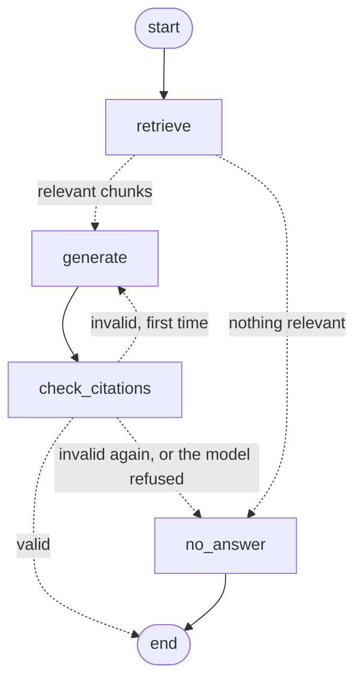

# Lesson 3 — Better retrieval: hybrid search, reranking, and a graph

> Phase 3, built at pace (build now, study later). Spec: `context/feature-specs/03-hybrid-retrieval-rerank-langgraph.md`.
> Every number here is real, from our corpus, 2026-10-31.

| Slice | Section | Status |
|-------|---------|--------|
| S1 | Keyword search and RRF | ✅ |
| S2 | Rerankers (cross-encoders) and thresholds | ✅ |
| S3 | The answering flow as a state machine (LangGraph) | ✅ |
| S4 | Comparing dense vs hybrid vs hybrid + rerank | ✅ |

---

## Why this phase: diagnose before fixing

The Phase 2 baseline failed g06 and g17. Measuring where their needed pages ranked in dense search showed they weren't far
away; they were **just below the top-5 cut**:

| Question | Page it needs | Dense rank |
|----------|---------------|-----------:|
| g06 "Who owns the SwiftParts contract … email?" | org chart | 6 |
| g17 "A supplier gave me a gift … who, and their email?" | employee handbook | 7 |

Plan: cast a **wider net** (20 candidates), from two kinds of search, then **reorder carefully** and keep the best 5.

---

## S1 — Keyword search and Reciprocal Rank Fusion (ISS-030)

**Dense search** (Phase 1–2) compares *meanings*: great for "days off" ≈ "annual leave", weaker on exact names.
**Keyword search** finds chunks that *contain the words*: great for `SwiftParts`, `SafeSite`, `gift`.

How ours works (`app/retrieval/pg_search.py`):
- Migration `0002` adds `chunks.content_tsv`: Postgres' searchable version of each chunk (words reduced to stems,
  stop words like "the" removed), **generated automatically** from `content`, plus a **GIN index** (the keyword equivalent
  of HNSW).
- The question becomes an **OR** of its words (`Who or owns or the or SwiftParts or …`), so a long question still matches
  chunks that contain *some* of the words. `ts_rank_cd` ranks chunks with more matches, closer together, higher.
  This is close to the classic **BM25** ranking, but not identical.
- The same three security filters as dense search (company, active, role).

**Hybrid** = run both, then merge with **RRF (Reciprocal Rank Fusion)**: each chunk gets `1 / (60 + rank)` from each list,
and the scores are added. We combine **ranks**, not scores, because keyword scores (like 0.1) and similarities (like 0.8)
are on different scales. A chunk ranked well by *either* list rises; one ranked well by *both* rises most.

Worked example (a test): dense `[x, y, z]`, keyword `[z, w]` → z = 1/63 + 1/61 beats x = 1/61 → order z, x, y, w.

**Real result, mixed:**

| Page | Dense | Keyword | Hybrid |
|------|------:|--------:|-------:|
| g17 → handbook | 7 | **1** | **1** ✅ |
| g17 → org chart | 3 | 15 | 6 |
| g06 → org chart | 6 | 14 | 10 ❌ |

The org chart is a **two-hop** page: g06 asks "who owns the contract?", the contract says "Head of Procurement", and only the
org chart says that's Hannah Brooks. The question's words don't describe the org chart, so keyword search can't find it.
**Lesson:** a technique that is better on average can hurt specific cases, so measure per question.

---

## S2 — Rerankers and thresholds (ISS-031, ISS-034)

**Bi-encoder vs cross-encoder:**

| | Embeddings (bi-encoder) | Reranker (cross-encoder) |
|---|---|---|
| Reads | question and chunk **separately**, compares two vectors | question + chunk **together**, word by word |
| Speed | fast: chunks embedded once, in advance | slow: one model run per (question, chunk) pair |
| Precision | coarse | sharp |
| Use | search the whole corpus | reorder the 20 candidates |

Ours: `BAAI/bge-reranker-base`, **running on your Mac** (Apple MPS), so no text leaves the machine. First download ~1 GB
(5 min), then loaded from disk. Scores 0–1.

Real scores, the same pairs:

| Question vs chunk | Embedding similarity | Reranker |
|-------------------|---------------------:|---------:|
| "annual leave?" vs leave policy | 0.850 | **0.929** |
| "annual leave?" vs 3rd best chunk | 0.785 | **0.059** |
| "CEO's salary?" vs best chunk | 0.692 | **0.003** |

**The threshold idea:** if even the best chunk scores very low, say "I don't know" **without calling the LLM** (faster, free).

**What calibration showed:** across the 20 golden questions, the best reranker score was

- answerable: mostly 0.85–0.999, but **g13 = 0.049**, g17 = 0.087, g05 = 0.476
- unanswerable: mostly < 0.11, but **g10 = 0.479**, g19 = 0.267

The groups **overlap**, so any threshold that catches g10 would wrongly refuse g13. The threshold stays **0.0 (off)** and the
LLM's rule handles "I don't know" (ISS-034). **Lesson:** reranker scores *rank* well but aren't calibrated probabilities;
"0.05" doesn't mean "5% relevant".

---

## S3 — The flow as a state machine (ISS-032)

Before: one function did every step in order. Now (`app/answering/graph.py`) it's a **LangGraph** graph: named **nodes**
(steps) that read and update a shared **state** (question, retrieved chunks, replies, citations, status), joined by
**edges**; *conditional* edges decide where to go next.

New behaviour: **one retry**. If citations are missing or point to pages that weren't retrieved, the model gets its rejected
reply back plus a correction note (`RETRY_NOTE`) and one more try; if it fails again, No-Answer. If the model itself says
"I don't know", that's final, with no retry.

Why a graph: Phase 5 adds guards (input, context, grounding judge) and Phase 6 the audit trail; each becomes a node and a
couple of edges, not a rewrite. `Answerer.answer(question)` didn't change, so the CLI, API, and eval needed no change.

---

## S4 — Did it help? (ISS-033)

Three runs of the 20 golden questions, same day, same models; only retrieval changed:

| Metric | Dense | Hybrid | Hybrid + rerank |
|--------|------:|-------:|----------------:|
| recall@5 | 0.929 | 0.929 | 0.929 |
| MRR | 0.917 | 0.964 | **1.000** |
| key-fact score | 0.857 | 0.857 | 0.857 |
| answered | 12/14 | 12/14 | 12/14 |
| No-Answer accuracy | 6/6 | 6/6 | 6/6 |

**Reading it honestly:**
- **Better ordering:** with hybrid + rerank the right page is **first** for every answerable question (MRR 1.000). Better
  ordering matters: the LLM reads the most relevant text first, and later phases may send fewer chunks.
- **Not better coverage:** recall@5 and "answered" didn't move. g06 and g17 still need the org chart, a **two-hop** page:
  the question doesn't describe it, so neither meaning nor keywords nor a reranker can pick it. The fix is a different
  technique, **multi-step retrieval** (search, read "Head of Procurement", search again), logged on ISS-017.
- **Nothing got worse**, so hybrid + rerank is the new default.
- **Dense reproduced the Phase 2 baseline exactly** (0.929 / 0.917 / 0.857), which shows the eval is repeatable: a precondition for trusting any comparison.
- Timing (8–20 s) mostly measures Groq's free tier, not our system (ISS-029).

## Explain it back (later)

1. Why does RRF use ranks instead of the two searches' scores?
2. Why did hybrid search *hurt* the org chart for g06?
3. What does a cross-encoder do that embeddings can't, and why not use it on every chunk?
4. Why couldn't we set a relevance threshold, and what handles "I don't know" instead?
5. What happens, step by step in the graph, when the model forgets its citations?
6. Hybrid + rerank improved MRR but not recall@5: what's the difference, and why couldn't reranking fix g06?
