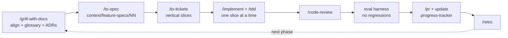
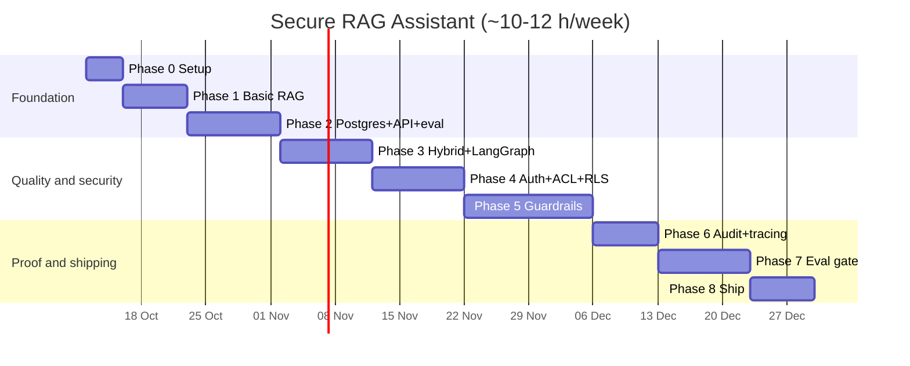

# Plan — Secure RAG Assistant

What we're building, why, how, what we need, and the order we'll do it in.
Design details live in [docs/architecture.md](docs/architecture.md); this file is the roadmap.

---

## 1. What we're building

An assistant that answers questions from a company's private documents (handbooks, policies,
contracts) and is **safe enough to ship**:

- answers **only** from documents the user is allowed to see, with citations — or says "I don't know"
- blocks prompt injection, including instructions hidden *inside* documents
- hides personal data (emails, phone numbers, IDs) from people without permission
- keeps a **tamper-evident audit log** of every decision
- is **measured** by an evaluation suite that blocks bad changes in CI

## 2. Why this project

| Reason | Detail |
|--------|--------|
| **It's what companies build** | Internal-docs Q&A is the most common enterprise LLM use case. Every real deployment hits the same problems: leakage, injection, PII, hallucination, "how do we know it's good?" |
| **It separates you from other candidates** | A basic RAG demo is the baseline. Access control, guardrails, audit, and an eval gate with real numbers are what production teams actually ask about in interviews. |
| **It teaches the full stack of applied AI** | Embeddings, retrieval, reranking, LLM orchestration, evaluation, security, and shipping — in one coherent system. |
| **It builds on what you've started** | Your `chatmodels/` and `embeddingmodels/` code (LangChain, `init_chat_model`, OpenAI/Groq/HF) is exactly the starting layer. |

## 3. What you'll have at the end

- A public GitHub repo with clean, tested code and a README that leads with **measured** results.
- An **eval report**: retrieval recall, answer correctness, faithfulness, injection block rate, false refusals, leakage, latency.
- A 2–3 minute demo video: normal answer → "I don't know" → injection blocked → PII masked → audit trail.
- Resume bullets and interview talking points backed by your own numbers (§10).
- A real understanding of *why* each piece exists — not just code that runs.

---

## 4. Everything we need

### 4.1 Your machine (checked)

| Item | You have | Verdict |
|------|----------|---------|
| Computer | Apple M4, 16 GB RAM | ✅ Enough. Reranker + injection classifier run on CPU/MPS; no GPU needed. |
| Docker | 29.8 | ✅ For Postgres, Redis, Langfuse |
| uv | 0.12.6 | ✅ Python env + dependency manager |
| GitHub CLI | 2.100 | ✅ Repo, issues, PRs |
| Python | 3.14.7 | ⚠️ Too new for some ML libs (spaCy/Presidio, torch). **Use Python 3.12 for this project** via `uv python install 3.12`. |

### 4.2 Accounts & API keys

| Service | Used for | Status | Cost |
|---------|----------|--------|------|
| Groq | Main chat LLM (fast, cheap) | ✅ key in `.env` | Free tier is enough for development |
| OpenAI | Embeddings (`text-embedding-3-small`); optional judge model | ✅ key in `.env` | Cents for this corpus size |
| Hugging Face | Downloading reranker, injection classifier, local models | ✅ token in `.env` | Free |
| Google / Mistral | Alternate providers to prove models are swappable | ✅ keys in `.env` | Free tiers |
| Langfuse | Tracing (latency, tokens, cost per step) | ❌ needed in Phase 6 | Free (self-host in Docker or cloud free tier) |
| GitHub | Repo + Actions for the eval gate | ✅ | Free for public repos |

**Budget:** aim to keep total spend under ~$10–20, mostly from eval runs (many judge calls). Use Groq's free tier and local models wherever possible, and run the full eval suite only on PRs, not every save.

### 4.3 Software & libraries (added phase by phase, not all at once)

| Area | Libraries / tools | Phase |
|------|-------------------|-------|
| LLM orchestration | `langchain`, `langchain-core`, `langgraph`, provider packages you already have | 1, 3 |
| Document loading | `pypdf`, `docx2txt`, `beautifulsoup4`, `langchain-text-splitters` | 1 |
| Database | Docker image `pgvector/pgvector:pg16`, `psycopg[binary]`, `pgvector`, `alembic` (migrations) | 2 |
| API | `fastapi`, `uvicorn`, `pydantic-settings`, `pyjwt` | 2, 4 |
| Retrieval quality | `sentence-transformers` (bge reranker) | 3 |
| Guards | `transformers` + `torch` (injection classifier), `presidio-analyzer`, `presidio-anonymizer`, spaCy `en_core_web_lg` | 5 |
| Rate limiting / cache | Redis (Docker), `redis` | 4 |
| Observability | Langfuse (Docker), `langfuse` | 6 |
| Evaluation | `ragas`, `pytest`, GitHub Actions | 2 (minimal), 7 (full) |
| Packaging | `docker-compose.yml`, `Dockerfile` | 8 |

### 4.4 Knowledge you'll pick up (use `/teach` before each)

| Concept | Needed in |
|---------|-----------|
| Embeddings, cosine similarity, chunking trade-offs | Phase 1 |
| Vector indexes (HNSW), SQL basics, migrations | Phase 2 |
| Keyword search (BM25 / `tsvector`), Reciprocal Rank Fusion, cross-encoder reranking, LangGraph state machines | Phase 3 |
| JWT auth, RBAC, Postgres Row-Level Security, multi-tenancy | Phase 4 |
| Prompt injection (direct + indirect), PII detection, LLM-as-judge | Phase 5 |
| Hash chains, append-only logs, tracing | Phase 6 |
| Eval design, RAGAS metrics, confidence intervals, CI gates | Phase 7 |
| Docker Compose, writing a strong README | Phase 8 |

### 4.5 Data

- A **synthetic company corpus**: ~10–20 documents (handbook, leave policy, expense policy, IT security policy, 2–3 vendor contracts, an org chart page) for **two fake tenants**. Include fake emails/phones so PII masking has something to do, and plant **canary strings** in tenant B.
- Generate it with an LLM, then edit by hand so the facts are consistent (the eval depends on known answers).
- A **golden set** of questions with expected answers and sources, written while you create the corpus.

### 4.6 Claude Code setup

- Install Matt Pocock's skills: `claude plugin install mattpocock-skills@claude-plugins-official`
- Run `/setup-matt-pocock-skills` once in the project repo (after Phase 0 step 1).
- Agents read `CLAUDE.md` → `context/` → `docs/` before working (pattern from Arch-AI).

---

## 5. How we work (every phase)

**Why this loop:** most failures with AI-written code come from misalignment (fixed by grilling + specs),
weak feedback (fixed by TDD + eval), and messy design (fixed by review + deep modules).
Full rules: [context/ai-workflow-rules.md](context/ai-workflow-rules.md).

---

## 6. Phases

Time estimates assume **~10–12 hours/week**. Total ≈ **10–12 weeks**. Adjust freely — finishing
phases properly matters more than speed.

### Phase 0 — Setup (½ week)

**Why:** a clean, separate repo looks better to recruiters and lets the skills configure it properly.

- [ ] Make `secure-rag-assistant/` its own Git repo on GitHub (public)
- [x] `uv init`, pin Python 3.12, add a project `pyproject.toml`
- [x] Copy `.env` keys you need into the new repo's `.env` (never commit it; add `.env.example`)
- [ ] Install Matt Pocock skills, run `/setup-matt-pocock-skills`
- [x] Decide the open questions (§9)

**Done when:** `uv run python -c "import langchain"` works in the new repo and the skills are configured.

### Phase 1 — Basic RAG pipeline (1 week)

**Why:** you can't secure or measure something that doesn't work yet. This is the skeleton every later phase hardens.
Spec: [context/feature-specs/01-basic-rag-pipeline.md](context/feature-specs/01-basic-rag-pipeline.md)

- [ ] Write the synthetic corpus for tenant A + 10 golden questions
- [ ] Load → chunk → embed → in-memory store → retrieve top-5
- [ ] Prompt that forces citations or "I don't know"; validate citations
- [ ] CLI: `python -m app.cli "question"`

**Learn:** embeddings, chunking, why citations matter.
**Done when:** answerable questions get cited answers; unanswerable ones get the No-Answer.

### Phase 2 — Postgres, API, and a baseline eval (1.5 weeks)

**Why:** real systems need a real database and API — and measuring from day one means every later phase proves it helped.

- [ ] Docker Compose with `pgvector/pgvector:pg16`
- [ ] Alembic migrations: `tenants`, `users`, `documents`, `chunks` (HNSW index)
- [ ] Ingestion script writes chunks to Postgres
- [ ] FastAPI `POST /v1/ask` returning `{answer, citations, status}`
- [ ] **Minimal eval harness**: 20 golden questions → recall@5 + answer correctness → JSON report

**Learn:** vector DBs, HNSW, API design, eval basics.
**Done when:** `/v1/ask` works and you have a baseline score saved.

### Phase 3 — Better retrieval + LangGraph (1.5 weeks)

**Why:** most bad RAG answers are retrieval failures, not LLM failures. Hybrid search and reranking are the biggest quality wins.

- [ ] Add `tsvector` keyword search; fuse with vector results using RRF
- [ ] Add bge cross-encoder reranker with a score threshold → No-Answer
- [ ] Move the flow into LangGraph (retrieve → rerank → generate → check citations)
- [ ] Eval: compare **dense-only vs hybrid vs hybrid+rerank**

**Learn:** BM25, RRF, cross-encoders, state machines.
**Done when:** eval shows hybrid+rerank beats dense-only (write the numbers in the tracker).

### Phase 4 — Auth, tenants, and access control (1.5 weeks)

**Why:** data leakage is the #1 blocker for enterprise RAG. Enforcing it in the database (not in Python) makes it hard to get wrong.

- [ ] JWT auth; roles and permissions loaded from DB per request
- [ ] Second tenant (B) with canary strings
- [ ] Row-Level Security on tenant tables + `SET LOCAL app.tenant_id` helper
- [ ] Role filter in hybrid search; `PATCH /v1/documents/{id}/acl` (one transaction)
- [ ] Upload endpoint with `uploader` role; ingestion jobs table + worker
- [ ] Redis rate limiting
- [ ] Tests: tenant A never retrieves tenant B; removed role retrieves nothing

**Learn:** RBAC, RLS, multi-tenancy, background jobs.
**Done when:** leakage tests pass and a deliberately removed `WHERE` clause still can't leak (RLS catches it).

### Phase 5 — Guardrails (2 weeks)

**Why:** prompt injection and PII leakage are what security reviewers ask about first. This is the core of the project's name.

- [ ] Input guard: injection classifier + rules → Refusal
- [ ] Ingest-time chunk scan → quarantine
- [ ] Context guard: drop flagged chunks; mask PII for users without `pii:read`
- [ ] Output checks: citations valid, strip URLs/images/HTML, PII/secret redaction
- [ ] Grounding judge (different model family), retry once → No-Answer
- [ ] Fail closed on guard timeout/outage
- [ ] Start the adversarial set (~50 cases) and benign set

**Learn:** direct vs indirect injection, Presidio, LLM-as-judge, defense in depth.
**Done when:** each guard has tests, and early block-rate / false-refusal numbers are recorded.

### Phase 6 — Audit trail + observability (1 week)

**Why:** regulated companies must explain every AI decision after the fact. "Show me why it said that" is a common interview question.

- [ ] `requests` (written at start) + `audit_events` (hash-chained, trigger blocks UPDATE/DELETE)
- [ ] Every guard verdict appended
- [ ] `GET /v1/audit/requests/{id}`, search, `GET /v1/audit/verify` (auditor, tenant-scoped)
- [ ] Langfuse in Docker with redacted traces

**Learn:** hash chains, append-only design, tracing.
**Done when:** you can open any request and see every decision; tampering with a row is detected by `/verify`.

### Phase 7 — Full evaluation + CI gate (1.5 weeks)

**Why:** "it seems better" isn't engineering. This phase produces the numbers that go on your resume.

- [ ] Grow adversarial set to ≥ 300 (public benchmark cases + your own), benign set ≥ 300
- [ ] Metrics: recall@5, answer correctness, faithfulness, block rate with 95 % CI, false refusals, canary leaks, ACL-change test, p50/p95 latency, cost/query
- [ ] Pin judge models in `eval/thresholds.yaml`
- [ ] GitHub Actions: run eval on PRs touching retrieval/guards/prompts; fail if thresholds missed
- [ ] HTML report with diff vs `main`

**Learn:** eval design, statistics for small samples, CI.
**Done when:** a PR that weakens a guard is automatically blocked.

### Phase 8 — Ship it (1 week)

**Why:** an unfinished-looking repo hides good work. Presentation is part of the job.

- [ ] One-command `docker compose up` with seeded demo data
- [ ] README: problem, architecture diagram, **results table**, how to run, limitations
- [ ] Demo video (2–3 min)
- [ ] Optional: blog post — "What I learned securing a RAG system"

**Done when:** a stranger can clone, run, and understand the project in 10 minutes.

---

## 7. Timeline at a glance

---

## 8. Risks and how we handle them

| Risk | Mitigation |
|------|------------|
| Scope creep (it's a big design) | Phases are independently useful. If time runs out after Phase 5, you still have a strong project; Phases 6–8 add polish. |
| Python 3.14 incompatibilities | Use Python 3.12 for this project from day one. |
| API costs from eval runs | Groq free tier, local models, cache embeddings, full eval only on PRs. |
| LLM-judge scores are noisy | Pin judge versions, report confidence intervals, compare against a saved baseline. |
| Injection classifier false positives on normal docs | Measure false refusals on the benign set; tune thresholds; rely on structural controls. |
| Getting stuck on a concept | `/teach` before the phase; `diagnosing-bugs` when something breaks; `/handoff` between sessions. |
| AI-written code you don't understand | Grill before building, review after; be able to explain every module in an interview. |

## 9. Decisions to make in Phase 0 (with recommendations)

| Question | Recommendation | Why |
|----------|----------------|-----|
| Embedding model | **OpenAI `text-embedding-3-small` (1536-d)** | You already have the key; costs cents; strong quality. Keep `bge-small` as the offline alternative. |
| Reranker hardware | **CPU / Apple MPS on your M4** | Fast enough for 20 pairs; no GPU needed. |
| Sample corpus | **Synthetic, LLM-generated, hand-edited** | You control the facts, so the golden set has correct answers. |
| Separate repo | **Yes** | Cleaner portfolio link; the skills set up per repo. |
| Main chat model | **Groq `openai/gpt-oss-120b`** | Fast and you already use it; swap to show provider independence. |
| Grounding judge | **A small model from a different family** (e.g. a Llama or Gemini Flash model) | Avoids the judge favouring its own model's style. |

## 10. What success looks like (resume + interview)

Fill in with **your measured numbers** at the end — never invented ones:

- "Built a multi-tenant RAG assistant with Postgres Row-Level Security and role-filtered hybrid search; **0 cross-tenant leaks** across N canary tests."
- "Designed layered prompt-injection defenses; **X % ± Y % block rate** on 300 adversarial cases with **Z % false refusals**."
- "Improved retrieval recall@5 from **A → B** with hybrid search + cross-encoder reranking."
- "Built an eval gate in GitHub Actions that blocks regressions in correctness, security, and latency (p95 **N s**)."
- "Implemented a hash-chained, append-only audit trail for every AI decision."

Interview talking points: why RLS instead of Python filtering, why no streaming, why mask PII at query
time, why a different judge model, what the system *can't* protect against (§14 of the architecture).

## 11. What we're deliberately not doing (and why)

| Not doing | Why |
|-----------|-----|
| Chat history / multi-turn | Adds query rewriting and new injection paths; single-turn proves the core skills first. |
| Agents with tools | The LLM having no tools is a security control here. Tools are a separate project (MCP / multi-agent). |
| Kubernetes | Docker Compose shows deployment skills without weeks of infra work. |
| Fine-tuning | That's the separate "learn the most about AI" project, planned after this one. |
| A polished UI | API + minimal page is enough; time goes to the parts interviewers probe. |

---

**Next action:** Phase 0 → create the separate repo, then `/grill-with-docs` on Phase 1.
